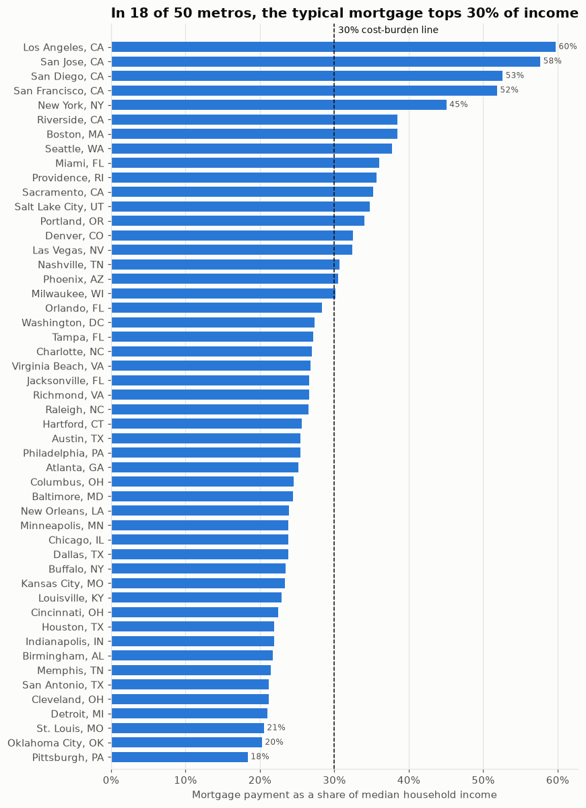
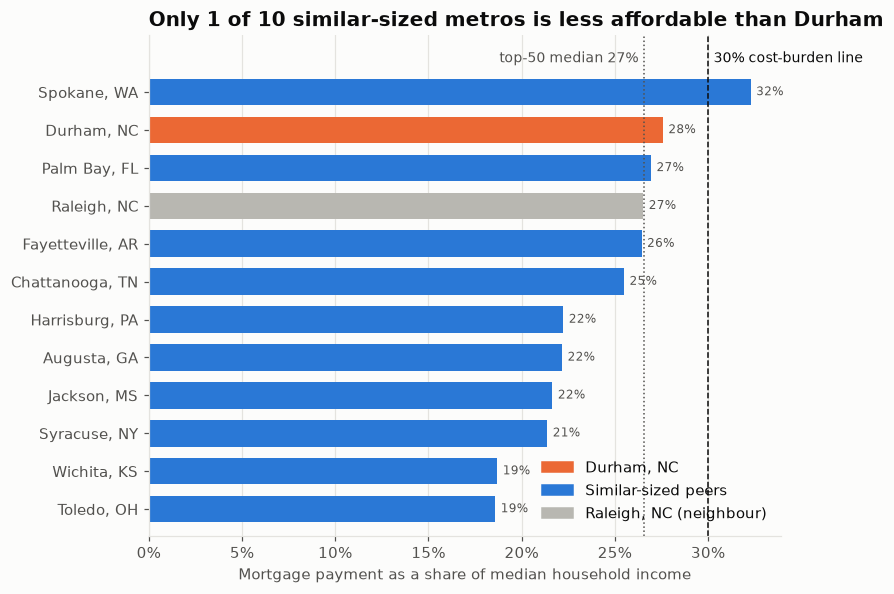

# City Housing Data

How affordable is housing in US metro areas, and are incomes keeping up with housing costs?
This project joins Zillow home values and rents with Census household income and
Freddie Mac mortgage rates to measure what a typical home costs a typical household.

It covers the 50 largest metros plus a **focus metro, Durham, NC**, and the 10 metros
closest to it in population (Spokane, Palm Bay, Fayetteville AR, Chattanooga, Harrisburg,
Augusta, Jackson MS, Syracuse, Wichita, Toledo).



## Findings so far (September 2026 prices, 2025 income)

- In **18 of 50 metros** the mortgage on a typical home (20% down, 30-year fixed) takes more
  than 30% of median household income, before taxes and insurance.
- Los Angeles (60%), San Jose (58%), San Diego (53%) and San Francisco (52%) are the least
  affordable; Pittsburgh (18%), Oklahoma City and St. Louis are the most.
- From 2021 to 2025 the median metro's payment-to-income rose about **9 percentage points**,
  driven mostly by mortgage rates roughly doubling.
- Owning a typical home costs more each month than renting one in **39 of 50 metros**.

See [notebooks/01_affordability.ipynb](notebooks/01_affordability.ipynb) for the charts and full table.

## Durham vs similar-sized metros



- A typical Durham mortgage takes **28% of median income**, more than the top-50 median (27%)
  and more than every peer except Spokane (32%).
- Since 2021, Durham's median household income rose **28%**, the same as home values (+28%)
  and faster than rents (+18%). The monthly mortgage payment rose **95%**, because rates
  went from about 3% to over 6%. Rates, more than prices, are what made Durham less affordable.
- Most of Durham's income gain came in 2025 (+10% in one year). One-year Census estimates for a
  metro this size carry a ±$4k margin of error, so treat any single year's move with caution.
- Across all 61 metros, home values grew faster than incomes in 35. Higher-income metros have
  pricier homes (r = 0.88), and Durham's homes are about $23k cheaper than its income level predicts.

See [notebooks/02_durham_and_peers.ipynb](notebooks/02_durham_and_peers.ipynb). To study a different
metro, rebuild with `python scripts/build_data.py --focus "Boise City, ID" --peers 10`
(use Zillow's metro name).

## Data sources

All are public downloads with no API key required.

| Source | What | Frequency |
|---|---|---|
| [Zillow Home Value Index](https://www.zillow.com/research/data/) | Typical home value (mid-tier, smoothed, seasonally adjusted) | Monthly, 2000– |
| [Zillow Observed Rent Index](https://www.zillow.com/research/data/) | Typical market rent | Monthly, 2015– |
| [Census ACS 1-year](https://www.census.gov/programs-surveys/acs/data/summary-file.html), tables B19013, B01003 | Median household income (with margin of error) and population by metro | Annual, 2021– |
| [Freddie Mac PMMS](https://www.freddiemac.com/pmms) | Average 30-year fixed mortgage rate | Weekly |

## Measures

| Measure | Definition |
|---|---|
| `price_to_income` | Home value ÷ median household income |
| `rent_to_income` | 12 × monthly rent ÷ median household income |
| `payment_to_income` | Monthly principal + interest (20% down, 30-year fixed) ÷ monthly median income |
| `*_index` | Income, home value, rent and mortgage payment relative to each metro's first year (= 100), to compare their growth on one scale |
| `group` | `focus`, `peer` (nearest in population to the focus metro) or `top` (50 largest) |

Zillow labels metros by first city ("Dallas, TX"); they're matched to Census CBSA codes by
first city and state in each year's own metro list, since the 2023 redelineation renumbered some
metros (e.g. Cleveland 17460 → 17410).

## Project layout

```
src/housing/        reusable package (sources, metro matching, metrics, pipeline)
scripts/            build_data.py: download sources and rebuild data/processed/
data/processed/     tidy CSVs: metro_monthly, metro_annual, metro_latest (committed)
data/raw/           cached downloads (git-ignored)
notebooks/          analysis notebooks
```

The `housing` package returns plain DataFrames, so a dashboard (e.g. Streamlit) can sit on
top of `housing.load_processed()` without changing the pipeline.

## Setup

```bash
python -m venv venv
venv\Scripts\activate          # macOS/Linux: source venv/bin/activate
pip install -r requirements.txt
python scripts/build_data.py   # add --refresh to re-download, --top N for more metros
jupyter notebook notebooks/
```

## Ideas for next steps

- Backfill income before 2021 (Census API, needs a free key) for a pre-pandemic baseline
- Add property tax and insurance to the monthly cost
- Interactive dashboard: pick metros, compare trends, map affordability
- Supply side: Census building permits vs population growth
